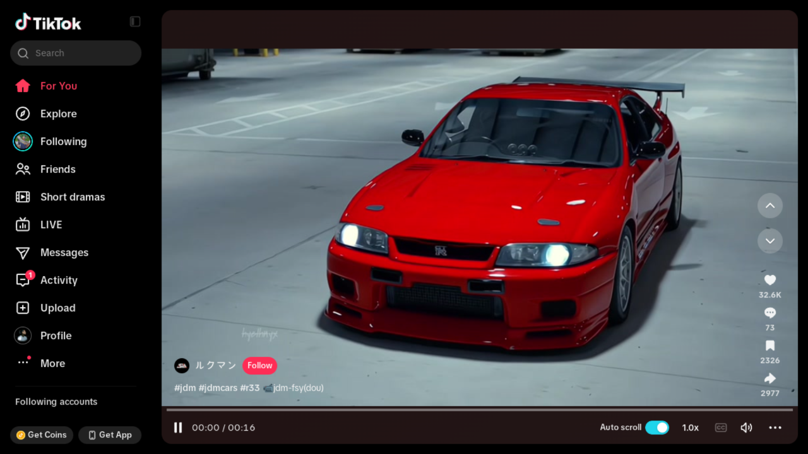
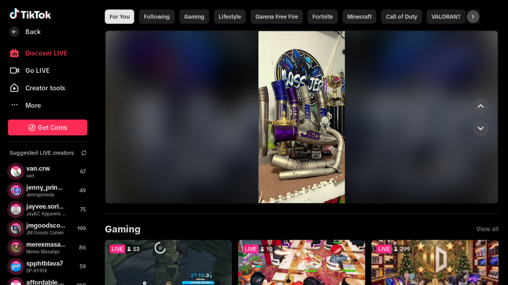

# TikTok for LG webOS (homebrew)

Unofficial TikTok app for LG webOS TVs. It opens the real TikTok **desktop** site (`https://www.tiktok.com`) full-screen,
and webOS injects a small script that adds remote-control mappings, zoom and playback fixes for a 10-foot UI.

**Created by aning and Cipher Amir with the help of Claude** (Anthropic's AI assistant).
Made for **Pie Amolong**, to watch AI dramas on an LG TV with TikTok.

Works on **rooted and non-rooted** TVs: no background service, no root access needed.

> Not affiliated with or endorsed by TikTok / ByteDance or LG. Use at your own risk. TikTok may change its site at any time and break this app.

## Screenshots

Captured on a real TV (LG 50UR7550, webOS 10.3.1) with the TV's own screen capture.

| For You feed | LIVE |
|---|---|
|  |  |

## Install

**Homebrew Channel (easiest, also gets updates):** add this app's repository once:

1. Open **Homebrew Channel** → **Settings** (gear icon).
2. Under **Repositories**, enter this URL and select **Add repository**:
   ```
   https://raw.githubusercontent.com/aningako/tiktok-webos/main/repo/apps.json
   ```
3. Go back to the app list, open **TikTok (unofficial)** and select **Install**.

New versions then show up in Homebrew Channel like any other app. Works on rooted and non-rooted (Dev Mode) TVs.

**Manual download:** get `com.homebrew.tiktok_<version>_all.ipk` from the
[latest release](https://github.com/aningako/tiktok-webos/releases/latest).

**Rooted TV (SSH / root shell):** copy the IPK to the TV and install it:

```sh
scp com.homebrew.tiktok_<version>_all.ipk root@<tv-ip>:/tmp/
ssh -t root@<tv-ip> "luna-send -i 'luna://com.webos.appInstallService/dev/install' '{\"id\":\"com.ares.defaultName\",\"ipkUrl\":\"/tmp/com.homebrew.tiktok_<version>_all.ipk\",\"subscribe\":true}'"
```
(Press Ctrl+C once it reports `installed`.)

**webOS CLI (Dev Mode):**

```sh
ares-setup-device                      # add your TV once
ares-install -d <tv> releases/com.homebrew.tiktok_<version>_all.ipk
ares-launch  -d <tv> com.homebrew.tiktok
```

Upgrading from 1.x: uninstall the old version first. 1.x included a proxy service that 2.x no longer uses.

## Logging in

Use **"Use QR code"** in the login dialog and scan it with the TikTok app on your phone. That's the most reliable method
on a TV. Email/phone + password also works with the on-screen keyboard. Google/Apple/Facebook sign-in opens pop-ups
that may not work inside a TV app.

## Remote controls

| Button | Action |
|---|---|
| Up / Down | Previous / next video (on LIVE: previous / next stream) |
| OK | Play / pause (or activate the focused button) |
| Right | Like |
| Left | Mute / unmute |
| Channel Up / Down | Zoom in / out (50–200%, saved) |
| Red / Green / Yellow / Blue | Reload / For You / Following / Explore |
| Back | Close dialog → go back → exit |

When a dialog (login, comments…) is open, the arrow keys move focus between its buttons and fields, and OK clicks.
The Magic Remote pointer works for clicking and scrolling everywhere.

## How it works

- `app/com.homebrew.tiktok/index.html` redirects to `https://www.tiktok.com/foryou`.
- `appinfo.json` sets `resolution: 1280x720`: the site renders at 1280×720 and the TV scales it up (about 150%),
  which gives readable text without breaking the layout. The stock webOS user-agent is used; TikTok serves the full
  desktop site to it, and request signing stays consistent because the page runs on the real origin.
- `app/com.homebrew.tiktok/webOSUserScripts/userScript.js` is injected by webOS WebAppManager into every page the app
  loads, the same mechanism [youtube-webos](https://github.com/webosbrew/youtube-webos) uses. It handles remote keys,
  zoom, an autoplay keeper, and playback workarounds (H.264 instead of HEVC, no MediaSource-in-Worker, and the
  `aweme/v1/play` video URL instead of the `v*-webapp-prime` ones, which need a cookie the TV's video player doesn't
  send). It also stops TikTok's endless CSS animations (a big CPU saving on the TV) and shows "Loading…" while
  TikTok switches pages.
- `appinfo.json` sets `disallowScrollingInMainFrame: false`; without it webOS ignores the Magic Remote wheel on
  pages that scroll as a whole (Explore, the Short dramas list).

## Known issues

- **Performance on low-end TVs:** tested on a 50UR7550 (webOS 10.3.1 "TV Lite", 4 cores, 1.2 GB RAM). TikTok's
  desktop site keeps that TV's CPU busy, so the first videos after launch can take 10–15s to start, the next video
  about 7–10s, and switching pages (Explore, Following, Short dramas…) 5–55s; the remote can lag a few seconds after
  each press. LIVE always reloads the whole page (TikTok's design). Close other apps (especially YouTube) so they don't hold memory or a
  video decoder.
- **Video playback:** these TVs have very few hardware video decoders, and TikTok keeps off-screen videos loaded.
  Since 2.1.0 the script makes TikTok use plain MP4s and frees the off-screen videos' decoders when the on-screen
  one stalls (see `userScript.js`).

### Why not a proxy anymore (1.x → 2.0)

1.x ran a Node.js reverse proxy on `127.0.0.1` that rewrote TikTok's pages. That made loading very slow (no
compression or connection reuse, multi-MB JS bundles rewritten on the TV CPU). It also broke the For You feed and
login: TikTok signs its API calls in the browser using the page origin and `navigator.userAgent`, and those didn't
match what the proxy sent, so the feed API returned nothing after the first few server-rendered videos. Login cookies
and the captcha also expect the real `tiktok.com` origin.

## Build

```sh
python3 scripts/build_ipk.py   # outputs releases/com.homebrew.tiktok_<version>_all.ipk (no SDK needed)
# or, with the webOS CLI:  npm run build
```

To release: bump the version in `app/com.homebrew.tiktok/appinfo.json` and `package.json`, update `CHANGELOG.md`, build,
then run `python3 scripts/make_repo.py` to update the Homebrew Channel repository in `repo/`. Commit, tag `v<version>`,
and publish a GitHub Release for that tag with the IPK attached (the repository downloads it from there).

## Debugging

In Dev Mode: `ares-inspect -d <tv> --app com.homebrew.tiktok --open` opens Chrome DevTools for the running app.

For scripted debugging there's `tools/cdp.py` (developer tool, not needed to use the app). It evaluates JS in the
app page, takes screenshots and sends remote keys over the TV's web inspector (port 9998):

```sh
pip install websocket-client
TV_HOST=<tv-ip> python3 tools/cdp.py eval 'document.querySelectorAll("video").length'
TV_HOST=<tv-ip> python3 tools/cdp.py key 40        # remote Down
TV_HOST=<tv-ip> python3 tools/cdp.py shot out.png  # video area shows blank: webOS draws video on its own plane
```

## Credits

Created by **aning** and **Cipher Amir** with the help of **Claude** (Anthropic).

Made for **Pie Amolong**, to watch AI dramas on an LG TV with TikTok.

## License
MIT
